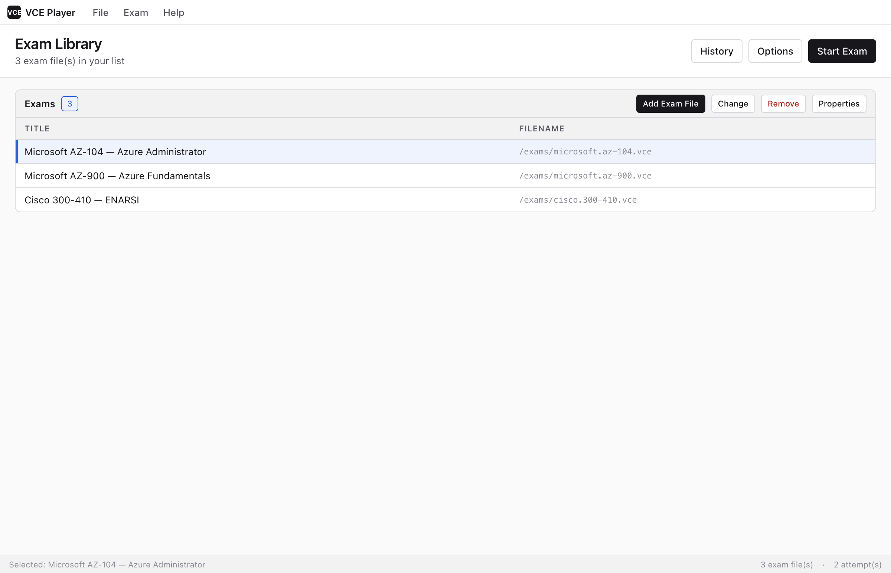
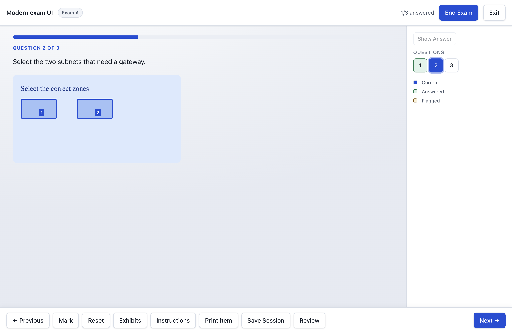
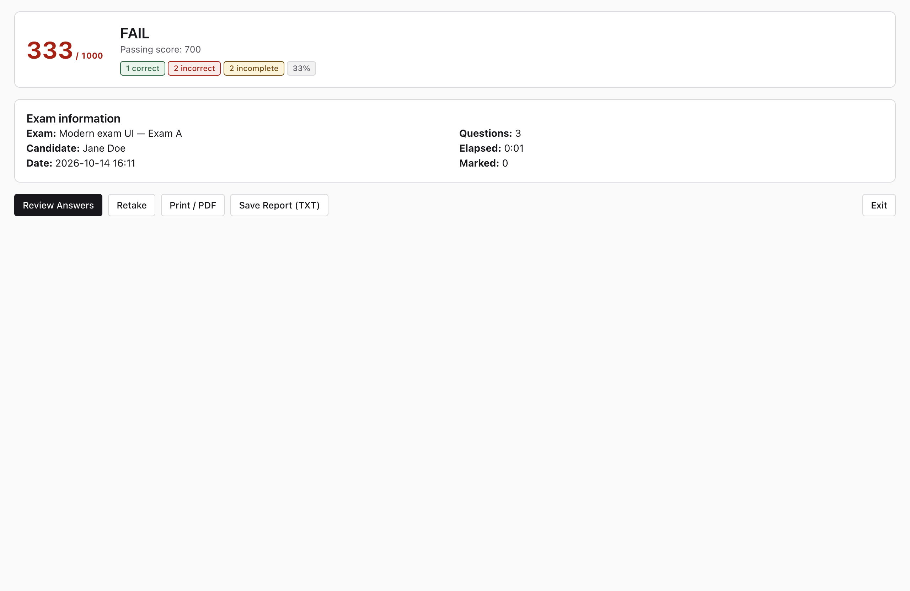

# VCE Exam Player

**Practice for your next certification exam, at your own pace.**

VCE Exam Player is an independent desktop app for opening and practicing with Visual CertExam (`.vce`) exam files. Build a library of your own exams, work through questions in a practice session, and review your results to see where to focus next. It is a recreation of the original player and does not include exam files or the original software.

## What you can do

- **Make practice your own:** take a full exam, choose sections or a range of questions, or revisit questions you previously got wrong. You can also shuffle questions and answers.
- **Work through different question types:** answer multiple-choice questions and interact with activities such as placing items, ordering lists and selecting areas of an image.
- **Stay in control:** mark questions for later, navigate between them, pause or save a session, and use training mode to show answers as you go.
- **Learn from your results:** review answers, see your score and section results, and return to your history. Reports can be printed or saved.
- **Make it comfortable:** choose a light, dark or high-contrast theme and adjust the text size.

### Practice and review

The exam screen keeps your progress and marked questions visible while you work.

When you finish, the score report gives you a starting point for reviewing your answers or trying again.

[See more screenshots](docs/screenshots/README.md)

## Get started

1. Download a macOS or Windows package from the [Releases page](https://github.com/TombSte/VcePlayerElectron/releases). Choose the macOS package for your Mac's processor (Apple silicon or Intel), or the Windows x64 installer.
2. On macOS, open the DMG and drag **VCE Player** into Applications. On Windows, run the installer.
3. Open the app, select **Add Exam File**, and choose a `.vce` file you are entitled to use.
4. Select the exam, choose **Start Exam**, and pick how you want to practice.

macOS builds use an ad hoc signature and are not notarized. After trying to open the app, use System Settings → Privacy & Security → Open Anyway if macOS blocks it and you trust the download. Windows builds are unsigned; installation and launch have not yet been verified on a Windows machine. See the [installation and build notes](docs/technical.md#build-and-install) for details.

## File compatibility

**The app cannot yet automatically open every `.vce` file.** Some protected files require an externally supplied decrypted key pool; this is separate from a file-opening password. Other files or format variants may also be unsupported or only partially readable. No exam files or keys are included.

If you have a decrypted key pool for a protected file, use **File → Open with Decrypt Key…**. For the current evidence and limitations, see [validation](docs/validation.md) and the [technical guide](docs/technical.md#vce-format-and-external-keys).

## For developers

The app is built with Electron, TypeScript and React. The [technical guide](docs/technical.md) covers development, tests, packaging, file formats, release automation and remaining work. Further details are available in the [feature checklist](docs/parity.md), [validation notes](docs/validation.md) and [release guide](docs/release.md).

## License

[MIT](LICENSE)
